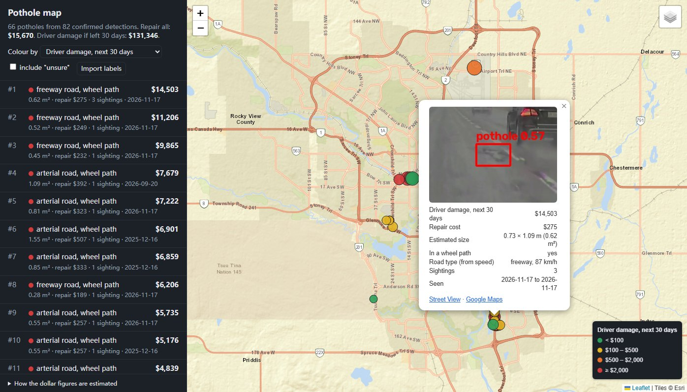
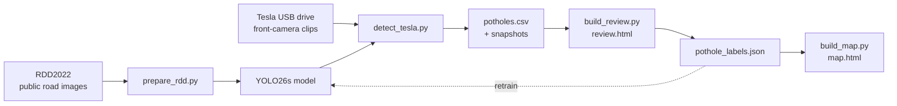
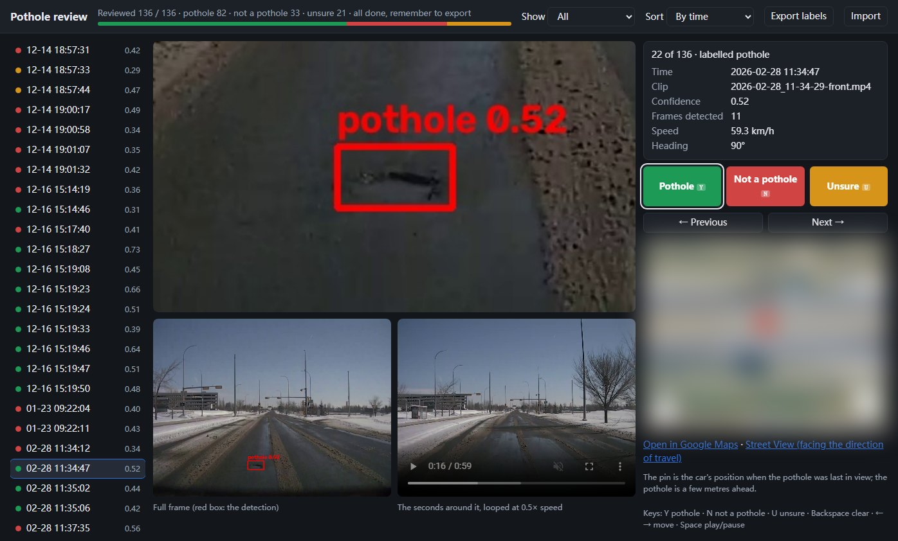

# Pothole detection from Tesla dashcam footage

Drive a street once and get its potholes on a map, each with a photo, a GPS position and a rough repair and damage cost. The model is YOLO26s trained on the public RDD2022 road-damage dataset. Positions come from the GPS data Tesla writes into every frame of its dashcam video, so the only input is footage the car already records.


*Reviewed potholes ranked by estimated driver damage over the next 30 days, with repair cost, size and road type for each.*

## Why

Calgary finds potholes through 311 reports and crew patrols. A car that records every drive could survey every street it passes, including during the spring freeze-thaw, when potholes appear fastest. This project covers the detection side: dashcam footage goes in, a person confirms each detection, and the potholes come out ranked by what they are likely to cost.

## How it works



1. **Train.** `prepare_rdd.py` converts 27,823 RDD2022 images from Japan, India, the Czech Republic, the United States and China from Pascal VOC to YOLO format. It keeps four classes: longitudinal crack, transverse crack, alligator crack and pothole.
2. **Detect.** `detect_tesla.py` runs the model on every frame of each front-camera clip. It tracks each pothole across frames so that it is reported once, and records the car's GPS position, speed and heading on the last frame the pothole was in view.
3. **Review.** `build_review.py` turns the results into a local web page. Each detection is shown zoomed in, in the full frame and in the surrounding seconds of video, and is marked with one keypress. The labels it exports become training data, including hard negatives.
4. **Rank.** `build_map.py` merges repeat sightings of each confirmed pothole and estimates its size, repair cost and the damage it is likely to cause drivers. It then plots everything on a city map, coloured by cost.


*The review page. The satellite map of the spot is blurred here.*

## Results

### Public benchmark: RDD2022 held-out test split

These numbers come from 2,743 test images that were not used for training or model selection.

| Class | mAP50 | Precision | Recall |
|---|---|---|---|
| All four classes | 0.642 | 0.67 | 0.59 |
| Longitudinal crack | 0.709 | 0.71 | 0.66 |
| Transverse crack | 0.627 | 0.64 | 0.59 |
| Alligator crack | 0.707 | 0.72 | 0.61 |
| **Pothole** | **0.527** | 0.63 | 0.49 |

Pothole precision and recall at different confidence thresholds, counting a box as correct at IoU ≥ 0.5:

| Threshold | Precision | Recall |
|---|---|---|
| 0.10 | 0.46 | 0.56 |
| 0.25 | 0.63 | 0.47 |
| 0.40 | 0.78 | 0.37 |
| 0.55 | 0.84 | 0.25 |

For comparison, an off-the-shelf open-vocabulary detector (YOLOE-26s, prompted with "pothole") found 3 of the 547 test potholes. The labelled training data is what makes the detector work.


*Held-out RDD2022 test images from Japan and India. Images: RDD2022, CC BY-SA 4.0.*

### Real Tesla footage in Calgary

- **Coverage.** The pipeline ran on 99 one-minute front-camera clips, about 80 km of driving between December 2025 and November 2026. It produced 136 detections, all of which were reviewed by hand.
- **Precision.** 82 detections were potholes, 33 were not, and 21 were unclear. That makes 71% of the detections that could be decided potholes (82 of 115). Merging sightings within 15 m of each other leaves 66 distinct potholes, 14 of which were seen more than once.
- **What fooled the model:**
  - snow patches, which look pale
  - manhole covers, which have a clean oval outline
  - reflections on wet pavement, which are easy to spot in the video because they move
  - oil stains and asphalt crack filler, which are dark but cast no shadow

  These four cases became the hard negatives in the retraining experiment below.


*Top: potholes the model found on a Calgary arterial in late February. Bottom: things that fooled it.*

### Retraining on the review labels

The next experiment fine-tuned the model on the review labels and tested it on drives it had not seen. The test set is four separate drives: 34 clips with 31 confirmed potholes and 14 rejected detections. `build_finetune.py` turned the other 27 reviewed clips into training data:

- 193 frames with confirmed potholes, taken only where the pothole was close enough to see clearly
- 74 frames with rejected detections, as hard negatives
- 135 plain-road frames with nothing pothole-like in them
- all 22,281 RDD2022 training images, so that the model keeps what it learned there

`eval_labels.py` then compared each new model's detections on the held-out drives with the original review.

| Model | Confirmed potholes kept (of 31) | Rejected detections kept (of 14) | New detections nobody reviewed | RDD2022 pothole mAP50 |
|---|---|---|---|---|
| Original | 31 | 14 | 0 | 0.527 |
| Fine-tune 1 | 27 | 6 | 43 | 0.408 |
| Fine-tune 2 | 27 | 6 | 48 | 0.525 |
| Original, with fine-tune 2 as a second opinion | 25 | 7 | 0 | – |
| Original, confidence ≥ 0.45 instead of 0.25 | 22 | 5 | 0 | – |

The fine-tuned models produce their own tracks, so `eval_labels.py` matches them to the reviewed ones by clip, time (±0.5 s) and GPS (within 20 m). The last two rows keep the original tracks, so their counts are exact.

- **Fine-tuning removed more than half of the known false alarms but created new ones.** Both fine-tunes dropped 8 of the 14 rejected detections and kept 27 of 31 potholes. They also flagged 43 and 48 spots that the original model had not. Judging by the snapshots, most of these are faint marks on wet-looking pavement. 35 of the 48 came from a single afternoon's drive.
- **The first fine-tune forgot part of RDD2022.** It trained for 20 epochs on a 4,000-image sample of RDD2022 with Ultralytics' default warm-up, and its pothole mAP50 fell from 0.527 to 0.408. The second trained for 4 epochs with SGD at a learning rate of 0.002, without warm-up and on all of RDD2022, and held it at 0.525.
- **A second opinion did no better than a stricter threshold.** Here the original model proposes potholes and the fine-tuned model has to find the same pothole in at least 3 frames. On the held-out drives, precision rose from 69% to 78% at the cost of 6 of the 31 potholes. Raising the confidence threshold to 0.45 gives 81% at the cost of 9. With 45 reviewed detections, the difference is within noise.

The original model therefore stays the default. A person reviews every detection anyway. Rejecting a false alarm takes one keypress, but nobody ever sees a missed pothole. Most confirmed potholes in both the training and the test drives come from a single day, 17 November 2026 (37 of 51 and 28 of 31), so these numbers mostly describe that day's conditions. The next round of training needs labelled drives from more days and weather, and a held-out set large enough to tell a real gain from noise.

### Ranking by cost

The map ranks each pothole by two rough estimates, in Canadian dollars:

- **Repair cost.** Calgary's $6.9M pothole program filled about 36,000 potholes in 2024, which is roughly $190 each. The model starts from a $120 base and adds $250 per m² of estimated area, so that a typical 0.3 m² pothole comes to about that average. For the 66 potholes, the median estimate is $189 and the total is about $15,700.
- **Damage to drivers if the pothole is left for 30 days.** This multiplies four factors: the traffic in the lane, the share of vehicles whose wheels go through the pothole, the chance a hit needs repairs, and $600 per repair. CAA puts typical pothole repair bills at $300 to $900. Lane traffic depends on road type, which is guessed from the car's speed. The share of vehicles that hit it is higher when the pothole sits in a wheel path. The chance of damage scales with size and speed.

The most expensive potholes are the ones in a wheel path on freeways and arterials. The absolute damage figures depend on guessed traffic and damage rates, so they are only good for ranking potholes against each other, not as quotes. The map lists every assumption next to the numbers.

## Engineering notes

- **GPS comes from the video itself.** Since firmware 2025.44.25 (HW3 and later), Tesla writes a protobuf into an H.264 SEI message before each frame. It records speed, heading, latitude and longitude, pedal and steering input, and three-axis acceleration. `detect_tesla.py` reads it straight from the MP4, without ffmpeg. Two checks on real clips:
  - Across 84 clips, the path length from GPS is 97–100% of the distance from integrating speed.
  - For 16 saved events, the nearest GPS fix is 1–33 m from the location Tesla records in the event's `event.json`.
- **Some frames have no GPS.** Frames recorded before the car pulls away carry no metadata. The script therefore matches metadata to frames by their position in the H.264 stream. Counting metadata records instead shifted positions by up to 144 frames; on one clip, the fix moved a pothole by 15.6 m.
- **Tracking.** Two Ultralytics defaults dropped real potholes:
  - The default tracker in 8.4 only starts a track at confidence 0.7, but most real potholes score 0.4–0.6.
  - Close to the car, a pothole moves too far between frames to be matched when only every other frame is processed.

  The script pins ByteTrack with score fusion turned off (`pothole_tracker.yaml`) and processes every frame.
- **Size from a single camera.** With the camera's 50° field of view and a height of about 1.4 m, the box width gives a usable estimate of how wide a pothole is: the median is 0.48 m. Most snapshots are taken 6–10 m away, where a few pixels of box height add up to metres of road. Length is therefore capped at 1.5 times the width.
- **Severity from the car's accelerometer (early finding).** In one clip, the car passed a confirmed pothole in its wheel path. Within half a second, its vertical acceleration swung between −1.8 and +1.9 m/s². Over the whole clip, vertical acceleration varies by 0.37 m/s² (one standard deviation). This is one example, not a validated measurement.
- **Training on an AMD GPU.** YOLO26s trained for 50 epochs on a Radeon RX 7900 XT under Windows, using AMD's ROCm 7.2.1 PyTorch wheels, at about 4.6 minutes per epoch. Detection and tracking run at about 0.67× real time on the same card, so an hour of driving takes about 40 minutes to process.

## Run it

Install Python 3.12 and PyTorch (the CUDA build, or AMD's ROCm wheels), then run `pip install -r requirements.txt`.

```bash
# 1. Convert RDD2022 (Pascal VOC) to YOLO labels and split lists
python prepare_rdd.py --root RDD2022 --countries Japan India Czech United_States China_MotorBike --out data/rdd2022_yolo

# 2. Train
yolo detect train data=data/rdd2022_yolo/rdd2022.yaml model=yolo26s.pt epochs=50 patience=15 imgsz=640 batch=32 workers=2

# 3. Find potholes in Tesla clips (a TeslaCam folder, or individual *-front.mp4 files)
python detect_tesla.py E:/TeslaCam --weights models/pothole_rdd_yolo26s.pt --out results

# 4. Review: open results/review.html in Chrome or Edge, label everything, then click "Export labels"
python build_review.py results --clips E:/TeslaCam

# 5. Rank and map: open results/map.html
python build_map.py results --labels pothole_labels.json

# 6. Optional: fine-tune on the review labels with whole drives held out, then score the new model on those drives
python build_finetune.py --labels pothole_labels.json --clips E:/TeslaCam --weights models/pothole_rdd_yolo26s.pt --rdd data/rdd2022_yolo --test 2026-01-23 2026-09-20 --out data/finetune
yolo detect train model=models/pothole_rdd_yolo26s.pt data=data/finetune/finetune.yaml epochs=4 optimizer=SGD lr0=0.002 lrf=0.1 warmup_epochs=0 imgsz=640 batch=32 workers=2
python detect_tesla.py E:/TeslaCam --weights runs/detect/train/weights/last.pt --out results_finetuned
python eval_labels.py --labels pothole_labels.json --reviewed results --new results_finetuned --test 2026-01-23 2026-09-20
```

If `--labels` is left out, the map reads the labels saved by the review page in the same browser. `results/potholes.csv` has one row per detection, with the time, confidence, box, latitude, longitude, heading, speed and snapshot. For browsers that cannot open local files, `serve_review.py` serves both pages over localhost.

## Repository

| Path | Purpose |
|---|---|
| `prepare_rdd.py` | Converts RDD2022 annotations to YOLO format with a hashed train/val/test split |
| `detect_tesla.py` | Detects, tracks and geolocates potholes in Tesla front-camera clips |
| `pothole_tracker.yaml` | Tracker settings used by `detect_tesla.py` |
| `build_review.py` | Generates the review page |
| `build_map.py` | Estimates size and cost for each pothole and generates the ranked map |
| `serve_review.py` | Serves the pages locally, with video seeking |
| `build_finetune.py` | Builds a fine-tuning set from the review labels, with rejected detections as hard negatives |
| `eval_labels.py` | Scores a new run against the review labels on held-out drives |
| `models/pothole_rdd_yolo26s.pt` | Trained weights (20 MB) |
| `docs/research_notes.md` | Research directions parked for later, each with a first experiment |

Dashcam footage, GPS tracks and review labels stay on the local machine and are not part of this repository.

## Next steps

1. **Label more drives before retraining again.** Two fine-tunes on 70 reviewed detections did not improve precision on held-out drives. The next attempt needs reviewed drives from more days and weather, and a larger held-out set.
2. **Measure severity with the accelerometer.** Drive over a few known potholes on purpose, align the camera with the axle timing, and see whether the jolt predicts depth and damage. Severity is the biggest unknown in the cost model.
3. **Compare against the City's own data.** Calgary publishes 311 pothole reports and repair status. Matching them against these detections would show which potholes were never reported and how much earlier the car saw them.
4. **Replace guessed traffic with real counts.** Use Calgary's open traffic-volume and road-class data instead of inferring road type from the car's speed.
5. **Locate potholes more precisely.** Estimate each pothole's own position, and its size from the closest frame, rather than using the car's position and the best-scoring frame.

[docs/research_notes.md](docs/research_notes.md) expands on these and other directions.

## Credits and licences

- RDD2022: Arya et al., *RDD2022: A multi-national image dataset for automatic road damage detection*, arXiv:2209.08538. The dataset's README gives the licence as CC BY-SA 4.0, while Figshare lists CC BY 4.0.
- [Ultralytics YOLO](https://github.com/ultralytics/ultralytics), AGPL-3.0.
- Tesla dashcam metadata format: [teslamotors/dashcam](https://github.com/teslamotors/dashcam).
- Map tiles: Esri. Repair cost: City of Calgary. Vehicle repair costs: CAA.
