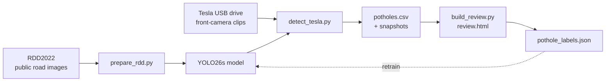
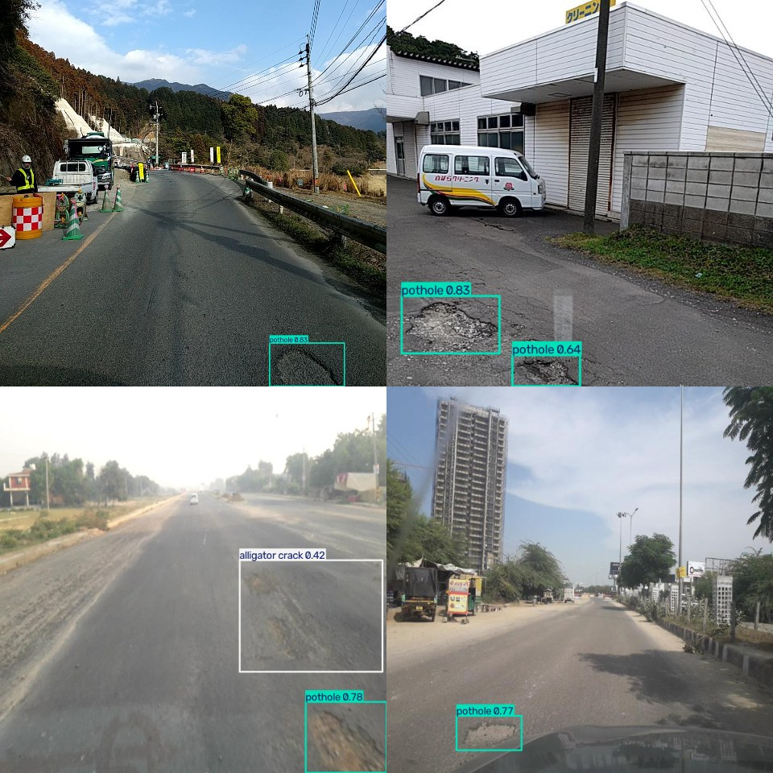
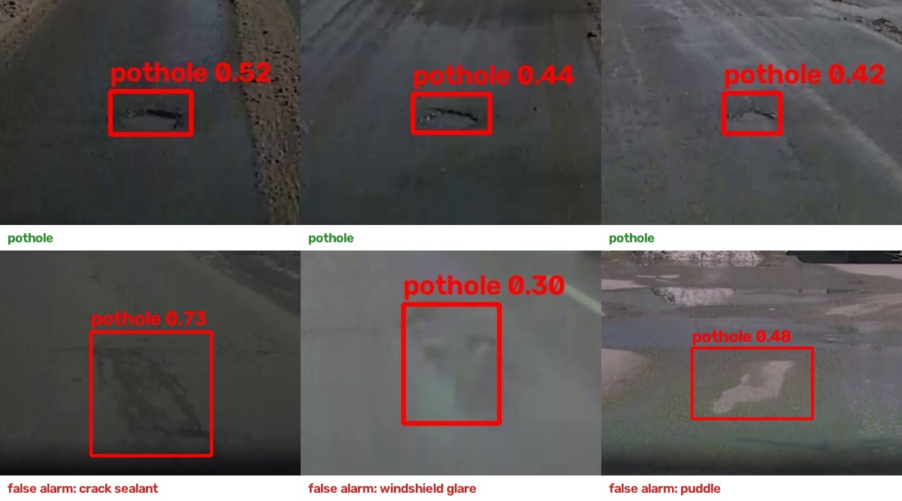

# Pothole detection from Tesla dashcam footage

Drive a street once and get a list of its potholes, each with a photo and a GPS position. The model is YOLO26s trained on the public RDD2022 road-damage dataset. Positions come from the GPS data Tesla writes into every frame of its dashcam video, so the only input is footage the car already records.


*The review page shows each detection zoomed in, the full frame, the surrounding seconds of video, and the spot on Google Maps (blurred here). One keypress accepts or rejects a detection.*

## Why

Calgary finds potholes through 311 reports and crew patrols. A car that records every drive could survey every street it passes, including during the spring freeze-thaw, when potholes appear fastest. This project covers the detection side: dashcam footage goes in, and located potholes come out after a quick human check, before anything is sent to the city.

## How it works



1. **Train.** `prepare_rdd.py` converts 27,823 RDD2022 images from Japan, India, the Czech Republic, the United States and China from Pascal VOC to YOLO format. It keeps four classes: longitudinal crack, transverse crack, alligator crack and pothole.
2. **Detect.** `detect_tesla.py` runs the model on every frame of each front-camera clip. It tracks each pothole across frames so that it is reported once, and records the car's GPS position, speed and heading on the last frame the pothole was in view.
3. **Review.** `build_review.py` turns the results into a local web page where each detection is marked as pothole, not a pothole, or unsure. The export becomes Calgary training data, including hard negatives such as crack sealant and glare.

## Results

### Public benchmark: RDD2022 held-out test split

These numbers come from 2,743 test images that were not used for training or model selection.

| Class | mAP50 | Precision | Recall |
|---|---|---|---|
| All four classes | 0.642 | 0.67 | 0.59 |
| Longitudinal crack | 0.709 | 0.71 | 0.66 |
| Transverse crack | 0.627 | 0.64 | 0.59 |
| Alligator crack | 0.707 | 0.72 | 0.61 |
| **Pothole** | **0.527** | 0.63 | 0.49 |

Pothole precision and recall at different confidence thresholds, counting a box as correct at IoU ≥ 0.5:

| Threshold | Precision | Recall |
|---|---|---|
| 0.10 | 0.46 | 0.56 |
| 0.25 | 0.63 | 0.47 |
| 0.40 | 0.78 | 0.37 |
| 0.55 | 0.84 | 0.25 |

For comparison, an off-the-shelf open-vocabulary detector (YOLOE-26s, prompted with "pothole") found 3 of the 547 test potholes, so the labelled training data is what makes detection work.


*Held-out RDD2022 test images from Japan and India. Images: RDD2022, CC BY-SA 4.0.*

### Real Tesla footage in Calgary

- **Coverage.** The pipeline ran on 99 one-minute front-camera clips with GPS, covering 80 km of driving between December 2025 and November 2026. It produced 136 tracked detections, 134 of them with a GPS position. They have not been reviewed yet.
- **First hand check.** 9 clips were picked to cover different seasons and times of day: a winter night, late February, April, summer and fall. The 16 detections in them break down as follows:
  - 3 clear potholes
  - 4 patches of pavement damage that may or may not be potholes
  - 4 false alarms: crack sealant, windshield glare and light-coloured patches
  - 3 in a private parking lot
  - 2 duplicates of the same pothole
- **Takeaway.** The model trained on public data finds real Calgary potholes, but it raises too many false alarms to hand straight to a city. The review page is there to fix that with local labels.


*Real detections, judged by eye. Top: potholes on a Calgary arterial in late February. Bottom: things that fooled the model.*

## Engineering notes

- **GPS comes from the video itself.** Since firmware 2025.44.25 (HW3 and later), Tesla writes a protobuf into an H.264 SEI message before each frame. It holds speed, heading, latitude and longitude, among other fields. `detect_tesla.py` reads it straight from the MP4 without ffmpeg. Two checks on real clips:
  - Across 84 clips, the path length from the GPS fixes is 97–100% of the distance from integrating speed.
  - For 16 saved events, the nearest GPS fix is 1–33 m from the location Tesla records in the event's `event.json`.
- **Some frames have no GPS.** Frames recorded before the car pulls away carry no metadata. The script therefore matches metadata to frames by their position in the H.264 stream. Counting records instead would have shifted positions by up to 144 frames; on one clip, the fix moved a pothole 15.6 m.
- **Tracking.** Two Ultralytics defaults dropped real potholes:
  - The default tracker in Ultralytics 8.4 only starts a track at confidence 0.7 or higher, but most real potholes score 0.4–0.6.
  - Close to the car, a pothole moves too far to be matched when only every other frame is processed.

  The script pins ByteTrack with score fusion turned off (`pothole_tracker.yaml`) and processes every frame.
- **Position accuracy.** Each row gives the car's position on the last frame the pothole was visible, so the pothole itself is a few metres ahead. The GPS error is estimated at 5–15 m but has not been measured. That is precise enough to find the block, but not the lane.
- **Training on an AMD GPU.** YOLO26s trained for 50 epochs on a Radeon RX 7900 XT under Windows, using AMD's ROCm 7.2.1 PyTorch wheels, at about 4.6 minutes per epoch. On the same card, detection and tracking run at about 0.67× real time, so an hour of driving takes about 40 minutes to process.

## Run it

Install Python 3.12 and PyTorch (the CUDA build, or AMD's ROCm wheels), then run `pip install -r requirements.txt`.

```bash
# 1. Convert RDD2022 (Pascal VOC) to YOLO labels and split lists
python prepare_rdd.py --root RDD2022 --countries Japan India Czech United_States China_MotorBike --out data/rdd2022_yolo

# 2. Train
yolo detect train data=data/rdd2022_yolo/rdd2022.yaml model=yolo26s.pt epochs=50 patience=15 imgsz=640 batch=32 workers=2

# 3. Find potholes in Tesla clips (a TeslaCam folder, or individual *-front.mp4 files)
python detect_tesla.py E:/TeslaCam --weights models/pothole_rdd_yolo26s.pt --out results

# 4. Build the review page, then open results/review.html in Chrome or Edge
python build_review.py results --clips E:/TeslaCam
```

`results/potholes.csv` has one row per pothole, with the clip, time, confidence, box, latitude, longitude, heading, speed and a snapshot path. Google My Maps can import the file as a map layer.

For browsers that cannot open local files, `serve_review.py` serves the review page over localhost and supports seeking in the videos.

## Repository

| Path | Purpose |
|---|---|
| `prepare_rdd.py` | Converts RDD2022 annotations to YOLO format with a hashed train/val/test split |
| `detect_tesla.py` | Detects, tracks and geolocates potholes in Tesla front-camera clips |
| `pothole_tracker.yaml` | Tracker settings used by `detect_tesla.py` |
| `build_review.py` | Generates the review page |
| `serve_review.py` | Serves the review page locally, with video seeking |
| `models/pothole_rdd_yolo26s.pt` | Trained weights (20 MB) |

Dashcam footage, GPS tracks and review labels stay on the local machine and are not part of this repository.

## Next steps

1. Review the 136 detections, retrain with Calgary potholes and hard negatives, then measure again on the same 9 validation clips.
2. Merge repeat sightings of the same pothole: 60 of the 136 detections have another detection within 20 m.
3. Estimate each pothole's own position from where it sits in the frame, rather than reporting the car's position.
4. Collect footage in March and April, when freeze-thaw potholes peak.

## Credits and licences

- RDD2022: Arya et al., *RDD2022: A multi-national image dataset for automatic road damage detection*, arXiv:2209.08538. The dataset's README gives the licence as CC BY-SA 4.0, while Figshare lists CC BY 4.0.
- [Ultralytics YOLO](https://github.com/ultralytics/ultralytics), AGPL-3.0.
- Tesla dashcam metadata format: [teslamotors/dashcam](https://github.com/teslamotors/dashcam).
